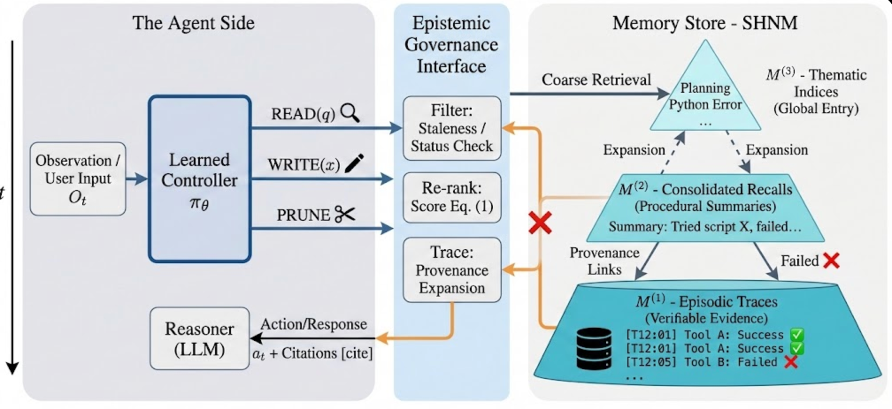

<h1 align="center">HELM: Steering Long-Horizon Agents with Learned Hierarchical Memory and Epistemic Governance</h1>

<p align="center"><b>EMNLP 2026</b></p>

<p align="center">
  <a href="https://github.com/Galleons2029/HELM"></a>
  
  
  <a href="../LICENSE"></a>
</p>

<p align="center">
  
</p>

## Overview

Long-horizon LLM agents often fail even when the right information is in memory: semantically relevant recalls can be
**epistemically invalid** — stale observations, failed tool traces, or claims contradicted by newer evidence — yet still get
retrieved as support. **HELM** (**H**ierarchical **E**pistemic **L**earned **M**emory) addresses this with:

- **Semantic-HNSW Nested Memory (SHNM)** — three tiers (episodic traces → consolidated recalls → thematic indices), each with its own HNSW index; every item keeps provenance and epistemic state.
- **Epistemic governance** — recalls are filtered and re-ranked by status, freshness, consistency, recency, and provenance (Eq. 1).
- **Explicit memory operations** — Read / Write / Consolidate / Prune, with provenance-linked cited recall that can be audited back to evidence spans.
- **Learned controller** — Stage 1 on-policy distillation + Stage 2 GSPO, on top of a tool-aware fine-tuned embedding model.

This repository is the reference implementation, plus a self-contained synthetic benchmark that runs the whole stack offline.

> **Scope.** This code implements the method as specified in the paper but does **not** reproduce its tables, which need
> GAIA / WebArena / Mind2Web / StreamBench / LifelongAgentBench, Qwen3-8B/32B, and ≈16 GPU-hours on 4×A100.
> Everything in `outputs/` comes from the synthetic simulator (`helm/sim`, `source = simulated`) and must not be mixed with the
> paper's numbers. Baselines are lightweight in-harness approximations; real-benchmark adapters and full-size training are
> not verified here (see [Status](#status)).

## Installation

```bash
git clone https://github.com/Galleons2029/HELM.git && cd HELM/code
pip install -e .                       # core only: numpy, pyyaml (requirements.txt also pulls torch, transformers, matplotlib, pandas)
```

Optional (`pip install -e ".[train,embed,llm,ann,plot]"`): `torch` + `transformers` (training), `sentence-transformers` (Qwen3-Embedding), `openai` (any OpenAI-compatible endpoint, e.g. vLLM), `hnswlib`, `matplotlib`.

## Quick Start

CPU only, no downloads, no API keys (~2 min end to end):

```bash
python3 -m unittest discover -s tests      # unit tests
python3 scripts/run_sim.py                 # baselines vs. HELM on the synthetic epistemic-trap benchmark
python3 scripts/run_ablations.py           # component / per-signal / layer / traversal ablations
python3 scripts/run_faithfulness.py        # A0 / A1 / A2 recall variants
python3 scripts/aggregate.py               # -> outputs/REPORT.md
```

More sweeps: `sweep_lambda_status.py`, `sweep_staleness.py`, `run_scaling.py`, and `run_sim.py --vigilant`.

### Using real models

Configure `configs/default.yaml` (or an overlay):

```yaml
embedding:  {backend: sentence_transformers, model_name: Qwen/Qwen3-Embedding-4B}
controller: {kind: llm}
reasoner:   {model: Qwen/Qwen3-8B, base_url: http://localhost:8000/v1}
```

### Training

```bash
python3 scripts/synthesize_data.py --smoke          # triplets, long-horizon haystacks, epistemic counterfactuals
python3 scripts/train_embedding.py --smoke          # tool-aware embedding (InfoNCE, hard negatives)
python3 scripts/train_controller_opd.py --smoke     # Stage 1: on-policy distillation
python3 scripts/train_controller_gspo.py --smoke    # Stage 2: GSPO, reward α·r_task + β·r_mem
```

`--smoke` runs tiny random-init Qwen3-config models on CPU to check the mechanics only; nothing here has been run on real weights.

### Real benchmarks

```bash
python3 scripts/run_benchmark.py --benchmark mind2web --method helm --data /path/to/mind2web --mock --limit 20
python3 scripts/run_benchmark.py --benchmark gaia --method helm --data /path/to/gaia \
    --llm-base-url http://localhost:8000/v1 --model Qwen/Qwen3-8B
```

All methods share one agent scaffold (identical decoding, tools, step limit, and budgets). Each CSV row carries a `source`
column; it is `measured` only when a real LLM client or embedding model produced the run.

## Paper → Code

| Paper | Code |
|---|---|
| SHNM, per-layer HNSW, budgets | `helm/memory/shnm.py`, `helm/index/` |
| Epistemic state, Eq. 1 governed score | `helm/memory/governance.py` |
| Retrieve / Consolidate / Prune | `helm/memory/{retrieve,consolidate,prune}.py` |
| Provenance pointers, `[[CITE …]]`, validation | `helm/memory/provenance.py` |
| `<recall>` interface, controllers | `helm/controller/` |
| CTU, EpiErr, provenance faithfulness | `helm/metrics/` |
| Baselines and ablations | `helm/baselines/`, `helm/methods.py`, `configs/ablations/` |
| Embedding FT, OPD, GSPO | `helm/training/` |
| GAIA, WebArena, Mind2Web, StreamBench, LifelongAgentBench adapters | `helm/benchmarks/` |
| Reproducibility table | `configs/default.yaml` |

## Status

| Component | State |
|---|---|
| Memory stack, governance, metrics, synthetic benchmark | implemented and unit-tested |
| Training (embedding / OPD / GSPO) | smoke-tested on tiny CPU models only |
| Benchmark adapters | tested on fixtures; WebArena and LifelongAgentBench need their official environments; the GAIA scorer is not diffed against the official one |
| Baselines | approximations of flat RAG, long context, MemGPT-, Mem0-, ArchRAG-style; HippoRAG, GraphRAG, MemGen, G-Memory not re-implemented |

Caveats of the simulator: it shows mechanism-level effects of governance and provenance, but **not** the benefit of hierarchy or
the paper's CTU reduction, and its effect sizes are much larger than the paper's because of its trap density. Hyper-parameters the
paper leaves unspecified are marked `# ASSUMPTION` in code and are not tuned to match any paper number.

## Repository Structure

```
configs/    default.yaml (paper hyper-parameters), ablations/*.yaml
helm/       memory/ index/ embedding/ controller/ llm/ baselines/ metrics/ sim/ training/ benchmarks/
scripts/    run_*.py, sweep_*.py, aggregate.py, training and benchmark CLIs
tests/      unittest suites
outputs/    generated CSV/JSON/PNG (git-ignored)
```

## Citation

HELM is accepted at **EMNLP 2026**. The BibTeX entry will be added once the proceedings reference is available.

## License

Released under the [MIT License](../LICENSE).
